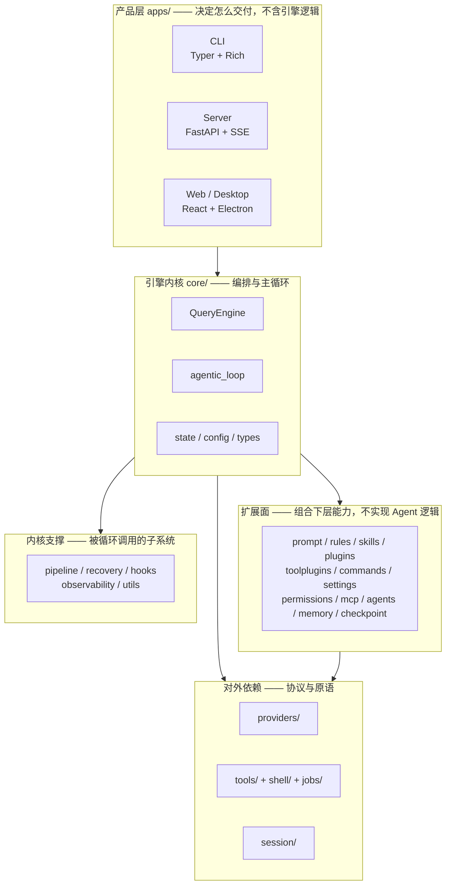
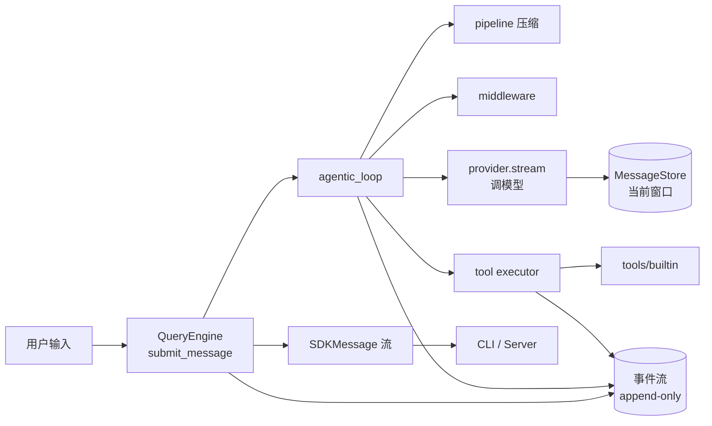

# 整体架构

> 上一篇走完了**一次对话**的流程。这一篇拉远一点，看**整个系统由什么拼成**。
> 如果你只读一篇，读这篇。

---

## 1. 一句话概括架构

Nono Agent 把整个系统拆成**两条正交的轴**：

- **轴一：能力怎么接进来** —— 六个可插拔协议（Provider / Tool / Pipeline / Middleware / Transcript / Permission）
- **轴二：状态怎么留下来** —— 一条只追加的事件流

这两条轴互相垂直，构成了理解整个代码库的骨架。

> 大部分 Agent 框架把"状态"存在一个消息数组里，于是"模型看到的上下文"就成了一个没人监管的可变对象。
> Nono Agent 的做法是：**所有状态从事件流推导出来**。想改上下文？先写事件。
> 这样"绕过日志偷改上下文"这件事，在架构上就没有存活空间。

---

## 2. 分层：四个层次



关键在于**依赖方向是单向的**：

```text
apps → core → {pipeline, recovery, hooks, providers, tools, session, permissions, …}
core ↛ apps          ← 引擎绝不知道产品层存在
plugins → {rules, skills, mcp, …}   ← 插件只组合，不反向依赖
```

**引擎里不允许出现 `import nono_app_*`。** 这条纪律换来的是：同一个引擎能被 CLI、Server、
库、桌面端随意复用；测试也能脱离任何产品层单跑。

---

## 3. 内核：引擎只有两个主角

整个 `core/`（约 3100 行）只有两个"主角"：

| 主角 | 文件 | 职责 | 规模感 |
|------|------|------|--------|
| `QueryEngine` | `core/engine.py` | 唯一的**对话入口**，管 turn 事务边界 | 引擎的门面 |
| `agentic_loop` | `core/loop.py` | 循环本体，反复"调模型→跑工具"直到收敛 | 引擎的心脏 |

其余的 `config.py` / `state.py` / `types.py` / `input_types.py` 都是支撑它们的数据与类型。

### 为什么是"流式生成器"而不是回调

`submit_message()` 返回的是 `AsyncGenerator[SDKMessage]`：

```python
async for msg in engine.submit_message("帮我修这个 bug"):
    if msg.type == "assistant":
        print(msg.message)
```

选流式而不是回调/事件总线，理由有三：

1. **数据流向明确**——消费者 `for` 一行就能拿全部中间结果，不用理解事件总线订阅语义。
2. **生命周期可控**——消费者 `break` 或退出 `async with`，生成器随之关闭。
3. **取消是天然的**——生成器关闭即取消，不需要额外约定一个 `cancel()`。

CLI 和 Server 消费的是**同一个**生成器，区别只是渲染方式：CLI 用 Rich 打到终端，
Server 用 SSE 推给浏览器。

---

## 4. 内核支撑：循环会调用的子系统

| 子系统 | 一句话职责 | 为什么必须有 |
|--------|-----------|-------------|
| [`pipeline/`](../architecture/context-compression.md) | 调用模型**前**分级压缩上下文 | 上下文会撞窗口，见压缩文档 |
| [`recovery/`](../architecture/nono-agent-architecture.md) | API 报错后分类并决定恢复动作 | Agent 不能因为一次 429 就崩 |
| [`hooks/`](../architecture/nono-agent-architecture.md) | 生命周期钩子（中间件 / 停止 / 采样后） | 给外部代码插入行为的正门 |
| [`observability/`](../architecture/session-observability.md) | token / 日志 / 指标 | 事后能回答"钱花在哪、哪慢了" |
| [`utils/`](../architecture/nono-agent-architecture.md) | Abort、token 估算、SSRF 闸门等原语 | 收口零散的系统级细节 |

---

## 5. 对外依赖：三大协议层

### 5.1 `providers/` —— 把不同厂商的 API 收敛成一种

现实里有三种主流协议：`openai_chat_completions` / `openai_responses` / `anthropic_messages`。
`providers/` 各写一个适配器，把它们统一成同一个 `LLMProvider` 协议
（`stream()` / `count_tokens()` / `normalize_messages()`）。

**为什么按"协议"而不是按"厂商"分类？**
因为很多厂商只是兼容其中一种 API 形态。按协议分类，接一个新供应商通常**零代码**
（填 `api_key` + `base_url` + 选个 adapter 即可），只有遇到全新的 API 形态才写适配器。

> 路由规则很直白：`config.adapter` 必须显式指定。未指定时只匹配显式注册过的前缀，
> **没有** `claude-*` / `gpt-*` 之类的隐式回退。宁可报错也不要猜错。

### 5.2 `tools/` + `shell/` + `jobs/` —— 能力

- `tools/`：工具协议 + 注册表 + 执行器；`tools/builtin/` 是 23 个零配置原语。
- `shell/`：一个值得学的设计——**工具不直接 spawn 进程**，它描述一次执行（`ShellSpec`），
  由执行器完成。见 [Shell 工具](../architecture/shell-tool.md)。
- `jobs/`：会话级后台作业注册表，让超时/后台命令可被前端任务板跟踪。

### 5.3 `session/` —— 状态的唯一真源

事件溯源的实现都在这里：`events.py`（事件信封 + 类型清单）、`derive.py`（事件→消息的纯函数）、
`transcript.py` / `db_transcript.py`（本地 JSONL / SQLite 后端）、`fork.py`（分叉）、
`redact.py`（脱敏）、`replay.py`（不调模型回放）。详见 [会话事件目录](../architecture/session-event-catalog.md)。

---

## 6. 扩展面：只组合，不实现逻辑

这一层是"别人往里加东西"的所有入口，共同点是**都不写 Agent 核心逻辑**：

| 包 | 解决什么 | 扩展方式 |
|----|---------|---------|
| `prompt/` | 系统提示由有序 section 组装（可缓存前缀） | 实现 `PromptSection.render()` |
| `rules/` | 常驻指令（`AGENTS.md` / `CLAUDE.md` 兼容） | 丢 `rules/*.md` |
| `skills/` | 按需能力包（渐进披露，只先进名字+描述） | 丢 `skills/<name>/SKILL.md` |
| `plugins/` | 把下层能力打包分发 | 写 `plugin.json` |
| `toolplugins/` | "开开关 + 填 Key"变成可用工具 | 写声明式 `plugin.json` |
| `commands/` | Slash 命令 | 实现 `SlashCommand` |
| `settings/` | 五层配置合并（default<user<project<policy<flag） | 改 `settings.json` |
| `permissions/` | 模式 + 规则 + 路径沙箱 + 拒绝追踪 | 配置化 |
| `mcp/` | 接外部 MCP server 的工具 | `~/.nono-agent/mcp.json` |
| `agents/` | 子 Agent 三件套 | `.nono-agent/agents/*.md` |
| `memory/` | 跨会话记忆（可治理、可过期、可覆盖） | 实现 `MemoryStore` |
| `checkpoint/` | 编辑快照回滚 | 实现 `CheckpointStore` |

> 这里有个贯穿全项目的模式：**协议（Protocol）定契约，基类（`XxxBase`）给便利默认。**
> 比如 `Tool` 协议 + `ToolBase` 基类——协议是约束，基类是绝大多数工具的起点。

---

## 7. 数据流：一次请求怎么穿过这些层



**注意两条并行线**：一条是"消息"往复（消息数组喂给模型、模型吐消息回来），
另一条是"事件"只往一个方向流（只追加，永不改写）。
前者决定模型看到什么，后者保证前者可复现。详见 [02 生命周期](02-request-lifecycle.md)。

---

## 8. 继续

- 每个模块具体做什么、边界在哪 → [04 · 模块地图](04-module-map.md)
- 为什么用这些技术而不是别的 → [05 · 技术选型](05-tech-choices.md)
- 每个设计决策背后的取舍 → [06 · 设计取舍](06-design-decisions.md)