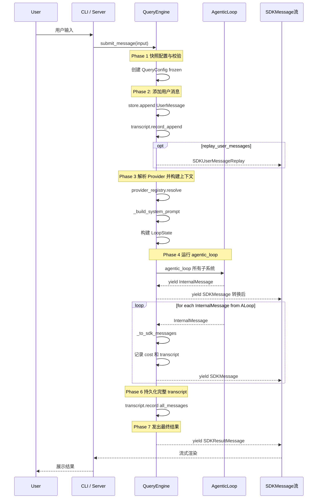
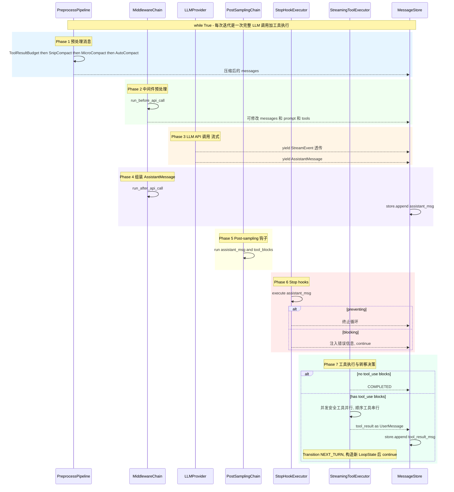
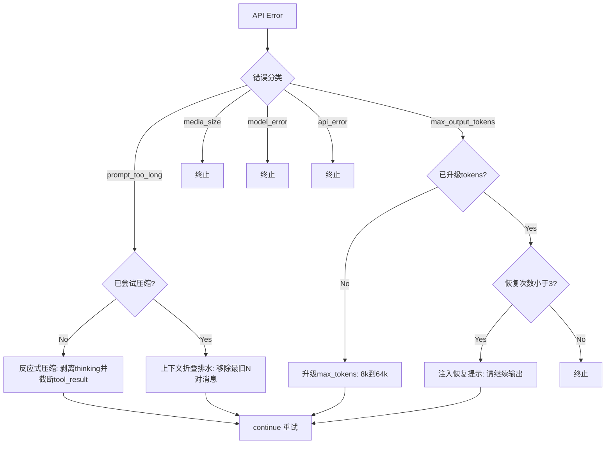
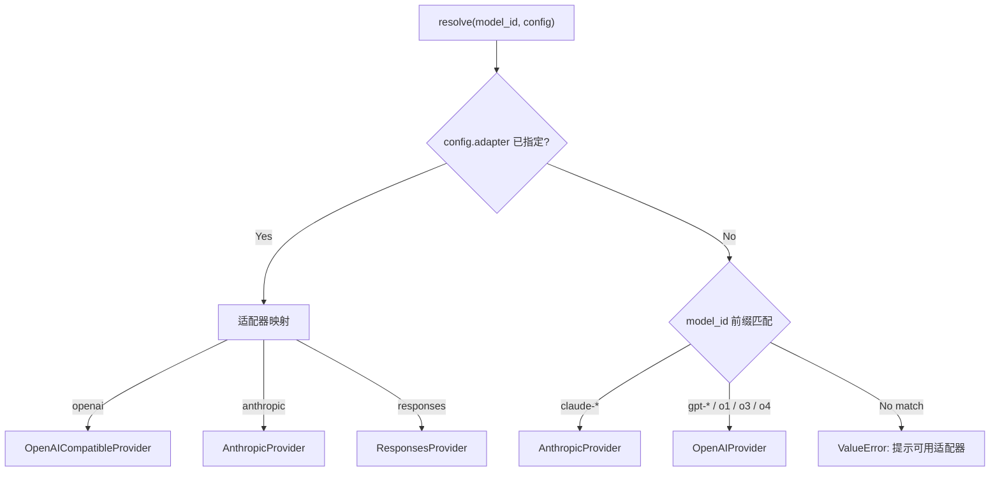

# Nono Agent —— 核心设计理念与系统架构

## 1. 项目概述

Nono Agent 是一个 Python AI Agent 引擎，灵感来源于 Claude Code 的 TypeScript QueryEngine 架构。它将经过验证的 Agent 设计理念（扣留-恢复机制、多层压缩管线、状态转移逻辑）重构为 Python 实现，同时在架构上做了关键改进以支持 CLI 终端交互和线上服务端 SDK 双场景。

**技术栈：** Python 3.11+ / Pydantic v2 / httpx / Anthropic SDK / OpenAI SDK / FastAPI / Rich / Typer

---

## 2. 核心设计理念

### 2.1 单一引擎内核，双侧适配

引擎只暴露一个公开 API —— `submit_message()`，返回 `AsyncGenerator[SDKMessage]`。CLI 适配器和服务端适配器消费同一个生成器，区别仅在于交付方式：

- **CLI**：本地 `async for` 消费，Rich 直接渲染到终端
- **Server**：通过 SSE/WebSocket 推送给远程 Web 客户端

```
                    ┌──────────────┐
                    │ QueryEngine  │
                    │              │
                    │ submit_msg() │──→ AsyncGenerator[SDKMessage]
                    └──────────────┘
                         │
              ┌──────────┴──────────┐
              ▼                     ▼
        ┌──────────┐         ┌──────────┐
        │   CLI    │         │  Server  │
        │ (Rich)   │         │  (SSE)   │
        └──────────┘         └──────────┘
```

### 2.2 不可变配置 + 运行时快照分离

配置架构将"不变"与"可变"分离：

| 类型 | 生命周期 | 作用 |
|------|---------|------|
| `EngineConfig` | 构造时设定，`frozen=True` | 模型、预算、系统提示等 |
| `QueryConfig` | 每次 `submit_message()` 入口冻结 | 运行时门控快照 |
| `LoopState` | 每次迭代构造新实例，`frozen=True` | 循环状态（轮次、恢复计数等） |

这解决了 TS 版的常见 bug：循环体内读取到运行期变化的环境状态。

### 2.3 强类型状态机

使用 `Enum` + `dataclass(frozen=True)` + `match/case` 穷举所有状态转移和终止原因：

- **7 种转移原因** (`TransitionReason`)：NEXT_TURN / MAX_OUTPUT_TOKENS_ESCALATE / MAX_OUTPUT_TOKENS_RECOVERY / REACTIVE_COMPACT_RETRY / COLLAPSE_DRAIN_RETRY / STOP_HOOK_BLOCKING / TOKEN_BUDGET_CONTINUATION
- **10 种终止原因** (`TerminalReason`)：COMPLETED / ABORTED_STREAMING / ABORTED_TOOLS / PROMPT_TOO_LONG / IMAGE_ERROR / MODEL_ERROR / BLOCKING_LIMIT / STOP_HOOK_PREVENTED / HOOK_STOPPED / MAX_TURNS

每次 `continue` 必须构造新的 `LoopState` 实例，编译器保证所有字段都被显式处理。

### 2.4 Fail-Closed 安全设计

工具协议采用安全默认值：
- `is_concurrent_safe = False` —— 默认不并发安全
- `has_write_side_effects = True` —— 默认假设有写副作用
- 权限检查器通过依赖注入，CLI 交互式确认，Server 默认拒绝所有写操作

### 2.5 协议驱动的可插拔架构

所有扩展点均基于 Python `Protocol`（结构化子类型），无需继承即可实现：

| 协议 | 职责 | 扩展方式 |
|------|------|---------|
| `LLMProvider` | LLM API 适配 | `ProviderRegistry` 注册 |
| `Tool` | 工具执行 | `ToolRegistry` 注册 |
| `PreprocessStage` | 预处理管线阶段 | `pipeline.register()` |
| `EngineMiddleware` | 生命周期钩子 | `MiddlewareChain.add()` |
| `TranscriptWriter` | 会话持久化 | 构造函数注入 |
| `PermissionChecker` | 权限策略 | 构造函数注入 |

### 2.6 高度透明的设计理念

引擎内部流转的消息（`InternalMessage`）与对外协议格式（`SDKMessage`）分离。`QueryEngine._to_sdk_messages()` 负责转换，外部消费者只看到标准化的 SDK 消息流。所有中间状态（流式事件、工具进度、压缩通知、Tombstone 清理）都通过事件透传给消费者。

---

## 3. 系统架构

### 3.1 模块分层

```
nono_agent/
├── core/                    # 核心引擎层
│   ├── engine.py            # QueryEngine — 顶层编排
│   ├── loop.py              # agentic_loop — while(True) 主循环
│   ├── config.py            # EngineConfig / QueryConfig / ProviderConfig
│   ├── state.py             # LoopState / Transition / Terminal
│   └── types.py             # 所有消息类型 + SDK 协议类型
│
├── adapters/                # 双侧适配器层
│   ├── cli.py               # CLI 适配器（Typer + Rich）
│   ├── server.py            # Server 适配器（FastAPI + SSE）
│   └── testing.py           # 测试适配器
│
├── providers/               # LLM Provider 层
│   ├── base.py              # LLMProvider Protocol + ProviderRegistry
│   ├── anthropic_provider.py # Anthropic Messages API
│   ├── openai_provider.py   # OpenAI Chat Completions API
│   ├── openai_compatible.py # 通用 OpenAI 兼容协议（MiniMax/DeepSeek 等）
│   └── responses_provider.py# OpenAI Responses API（预留）
│
├── pipeline/                # 预处理管线层
│   ├── base.py              # PreprocessPipeline + PreprocessStage Protocol
│   ├── tool_result_budget.py# 截断超长工具结果
│   ├── snip_compact.py      # 零成本滑动窗口丢弃
│   ├── microcompact.py      # 剥离旧 thinking + 截断长文本
│   ├── context_collapse.py  # LLM 摘要压缩旧消息
│   └── auto_compact.py      # 安全网（80%/95% 阈值）
│
├── hooks/                   # 生命周期钩子层
│   ├── middleware.py         # MiddlewareChain — 统一生命周期钩子
│   ├── stop_hooks.py        # StopHookExecutor — 响应校验/拦截
│   └── post_sampling.py     # PostSamplingChain — 采样后钩子
│
├── recovery/                # 错误恢复层
│   ├── chain.py             # RecoveryChain — 集中化恢复决策
│   ├── prompt_too_long.py   # 反应式压缩 + 上下文折叠排水
│   └── max_output_tokens.py # 输出截断恢复
│
├── tools/                   # 工具系统层
│   ├── protocol.py          # Tool Protocol + ToolBase
│   ├── registry.py          # ToolRegistry
│   ├── executor.py          # StreamingToolExecutor / BatchToolExecutor
│   └── context.py           # ToolUseContext + PermissionChecker
│
├── session/                 # 会话管理层
│   ├── store.py             # MessageStore — 统一消息存储
│   └── transcript.py        # TranscriptWriter Protocol + LocalFileTranscriptWriter
│
├── observability/           # 可观测性层
│   ├── cost_tracker.py      # CostTracker — token 用量 + 美元费用跟踪
│   ├── logging.py           # structlog 结构化日志
│   └── metrics.py           # 指标收集
│
└── utils/                   # 工具函数层
    ├── abort.py             # AbortController / AbortSignal
    └── tokens.py            # Token 估算工具
```

### 3.2 架构总览图


---

## 4. Engine → Loop 流程示意图

### 4.1 submit_message() 七阶段流程



### 4.2 Agentic Loop 内部七阶段循环



### 4.3 错误恢复链决策流程



### 4.4 预处理管线执行顺序


### 4.5 Provider 路由机制



---

## 5. 关键设计决策

### 5.1 消息存储：单一数据源 vs 三数组

TS 版使用三个独立数组（`mutableMessages`, `messages`, `messagesForQuery`）需要复杂同步。Python 版 `MessageStore` 提供单一数据源，通过 `snapshot_after_boundary()` 为 API 调用提供视图，通过 `gc_before_boundary()` 清理压缩前旧消息。

### 5.2 中间件链 vs 分散钩子

TS 版在多个位置分散调用 hook。Python 版用 `MiddlewareChain` 统一 6 个生命周期点，支持否决（`on_transition` 返回 `None` 终止循环），异常不中断链。

### 5.3 恢复链 vs 内联错误处理

TS 版的错误恢复逻辑散落在循环体内。Python 版 `RecoveryChain` 集中决策，使用 `match/case` 穷举匹配，恢复策略按优先级递进。

### 5.4 AsyncGenerator vs 回调

引擎使用 `AsyncGenerator` 而非回调或事件总线，使数据流方向明确、生命周期可控、取消机制自然（Generator 关闭即取消）。

---

## 6. 依赖注入全景

```
QueryEngine.__init__(
    config: EngineConfig,                    # 必填：不可变配置
    provider_registry: ProviderRegistry,     # 可选：LLM Provider 注册表
    tool_registry: ToolRegistry,             # 可选：工具注册表
    pipeline: PreprocessPipeline,            # 可选：预处理管线
    middleware_chain: MiddlewareChain,        # 可选：中间件链
    stop_hook_executor: StopHookExecutor,    # 可选：Stop hook 执行器
    post_sampling_chain: PostSamplingChain,  # 可选：采样后钩子链
    recovery_chain: RecoveryChain,           # 可选：恢复链
    transcript_writer: TranscriptWriter,     # 可选：会话持久化
    permission_checker: PermissionChecker,   # 可选：权限检查器（CLI/Server注入）
)
```

所有子系统"可注入或自动创建"——不传则创建默认实例。这使得测试时可以 mock 任意子系统，生产环境中 CLI 和 Server 只需注入各自的 `PermissionChecker`。
