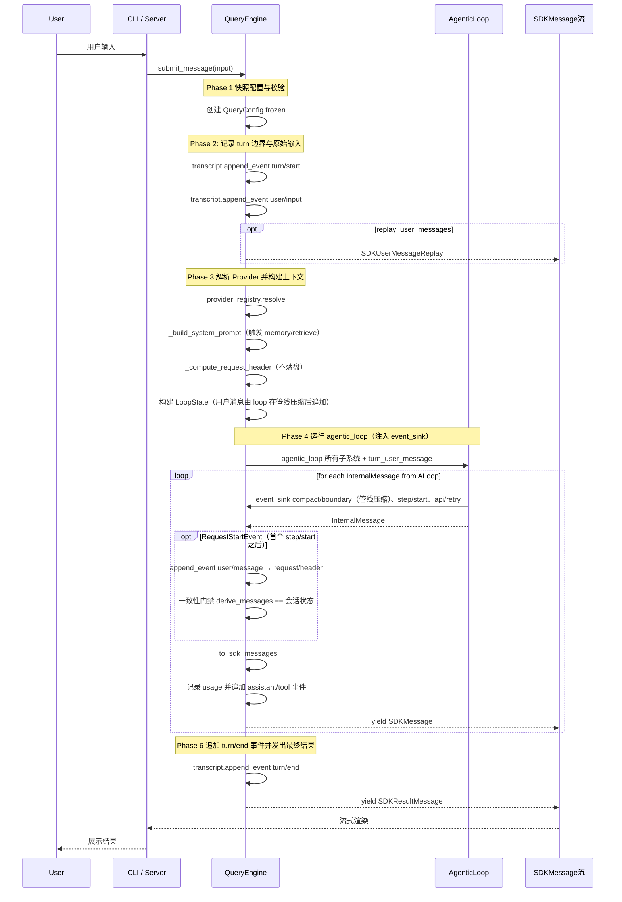
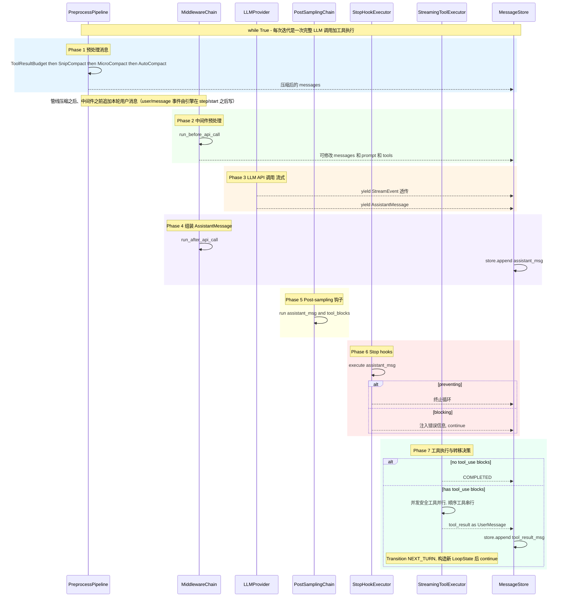
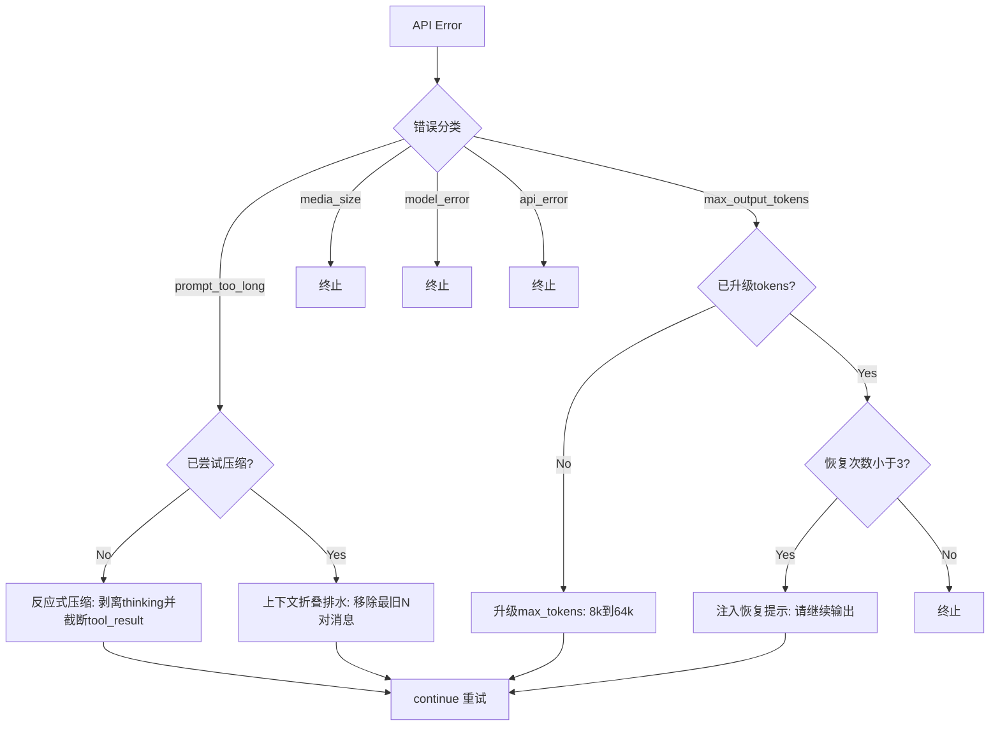
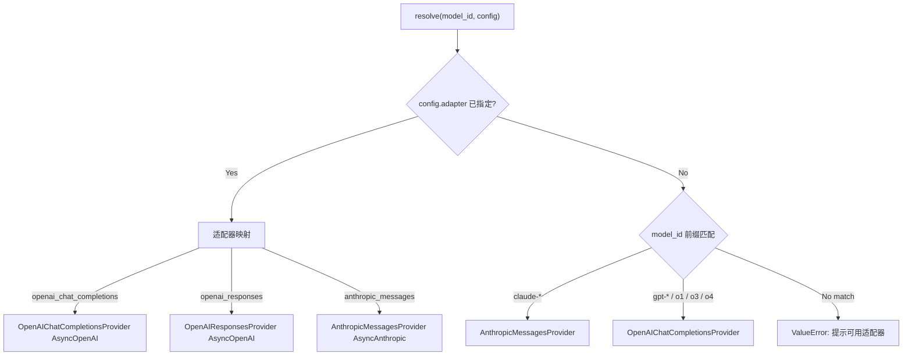

# Nono Agent —— 核心设计理念与系统架构

> **文档角色：** 描述目标架构与已落地设计。实现进度、缺口与打磨项见 [ROADMAP.md](./ROADMAP.md)。  
> **当前版本：** `0.1.0` —— 可扩展的 Agent **运行时骨架**，不是能力齐备的 Agent 产品。

## 1. 项目概述

Nono Agent 是一个 Python AI Agent 引擎，灵感来源于 Claude Code 的 TypeScript QueryEngine 架构。它将经过验证的 Agent 设计理念（扣留-恢复机制、多层压缩管线、状态转移逻辑）重构为 Python 实现，并在架构上支持 **CLI 终端** 与 **线上服务端 SDK** 双场景。

**技术栈：** Python 3.12+ / Pydantic v2 / httpx / Anthropic SDK / OpenAI SDK / FastAPI / Rich / Typer

### 1.1 实现状态总览

> 状态与 [ROADMAP.md §1](./ROADMAP.md) 对齐；已实现能力以 `可用需打磨` 为主，尚未实现仅剩 P2 可选与非目标项（Teams/Bridge/Cron、WebSocket、DB/Redis 后端等）。

| 层级 | 状态 | 说明 |
|------|------|------|
| 核心引擎（`QueryEngine` / `agentic_loop` / 状态机 / 恢复链） | 可用需打磨 | 主路径可跑通；边界/预算/取消等加固见 Roadmap §3 |
| 预处理管线 | 可用需打磨 | 默认 4 级；`ContextCollapse` 可配置启用（`context_collapse_enabled` + 默认 summarizer） |
| LLM Provider | 可用需打磨 | 三类协议：`openai_chat_completions` / `openai_responses` / `anthropic_messages` |
| 工具协议与执行器 | 可用需打磨 | 协议/注册表/执行器 + 22 个生产级内置工具（`tools/builtin/`） |
| Skills | 可用需打磨 | 含 SkillTool；见 Roadmap §2.3 |
| Rules / Plugins / Settings | 可用需打磨 | 常驻指令、扩展包、分层配置均已落地；见 Roadmap §2.2 / §2.5 / §2.6.1 |
| Prompt Section 组装 | 可用需打磨 | 对标 CC Prompt-Assembly；§2.0 |
| MCP | 可用需打磨 | stdio tools/resources 桥接已落地；auth/SSE 见 Roadmap §2.4 |
| 子 Agent 三件套 | 可用需打磨 | AgentTool + Definition + run；§2.8 |
| 权限模式 / Rule / denial / Hooks / Slash | 可用需打磨 | §2.6–§2.7 |
| 会话持久化（`TranscriptWriter`） | 事件溯源 | 落盘只有 `SessionEvent`；默认本地 JSONL，另有 SQLite；请求前一致性门禁默认开启；DB/Redis 等后端见 Roadmap |
| CLI / Server 适配器 | 可用需打磨 | Server 目前仅 SSE（WebSocket 为规划能力）；含鉴权/TTL/AskUser 回调与会话事件流通道 |
| 可观测性 | 可用 | TokenTracker + structlog + Metrics（内存实现，事件流自动投影为指标）；脱敏导出与回放已具备 |

---

## 2. 核心设计理念

### 2.1 单一引擎内核，双侧适配

引擎只暴露一个公开 API —— `submit_message()`，返回 `AsyncGenerator[SDKMessage]`。CLI 适配器和服务端适配器消费同一个生成器，区别仅在于交付方式：

- **CLI**：本地 `async for` 消费，Rich 直接渲染到终端
- **Server**：通过 SSE 推送给远程 Web 客户端（WebSocket 为规划能力，见 Roadmap）

```
                    ┌──────────────┐
                    │ QueryEngine  │
                    │              │
                    │ submit_msg() │──→ AsyncGenerator[SDKMessage]
                    └──────────────┘
                         │
              ┌──────────┴──────────┐
              ▼                     ▼
        ┌──────────┐         ┌──────────┐
        │   CLI    │         │  Server  │
        │ (Rich)   │         │  (SSE)   │
        └──────────┘         └──────────┘
```

### 2.2 不可变配置 + 运行时快照分离

配置架构将"不变"与"可变"分离：

| 类型 | 生命周期 | 作用 |
|------|---------|------|
| `EngineConfig` | 构造时设定，`frozen=True` | 模型、预算、系统提示等 |
| `QueryConfig` | 每次 `submit_message()` 入口冻结 | 运行时门控快照 |
| `LoopState` | 每次迭代构造新实例，`frozen=True` | 循环状态（轮次、恢复计数等） |

这解决了 TS 版的常见 bug：循环体内读取到运行期变化的环境状态。

### 2.3 强类型状态机

使用 `Enum` + `dataclass(frozen=True)` + `match/case` 穷举所有状态转移和终止原因：

- **7 种转移原因** (`TransitionReason`)：NEXT_TURN / MAX_OUTPUT_TOKENS_ESCALATE / MAX_OUTPUT_TOKENS_RECOVERY / REACTIVE_COMPACT_RETRY / COLLAPSE_DRAIN_RETRY / STOP_HOOK_BLOCKING / TOKEN_BUDGET_CONTINUATION
- **11 种终止原因** (`TerminalReason`)：COMPLETED / ABORTED_STREAMING / ABORTED_TOOLS / PROMPT_TOO_LONG / IMAGE_ERROR / MODEL_ERROR / BLOCKING_LIMIT / STOP_HOOK_PREVENTED / HOOK_STOPPED / MAX_TURNS / TASK_BUDGET_EXHAUSTED

每次 `continue` 必须构造新的 `LoopState` 实例，编译器保证所有字段都被显式处理。

### 2.4 Fail-Closed 安全设计

工具协议采用安全默认值：
- `is_concurrent_safe = False` —— 默认不并发安全
- `has_write_side_effects = True` —— 默认假设有写副作用
- 权限检查器通过依赖注入，CLI 交互式确认，Server 默认拒绝所有写操作

### 2.5 协议驱动的可插拔架构

所有扩展点均基于 Python `Protocol`（结构化子类型），无需继承即可实现：

| 协议 | 职责 | 扩展方式 |
|------|------|---------|
| `LLMProvider` | LLM API 适配 | `ProviderRegistry` 注册 |
| `Tool` | 工具执行 | `ToolRegistry` 注册 |
| `PreprocessStage` | 预处理管线阶段 | `pipeline.register()` |
| `EngineMiddleware` | 生命周期钩子 | `MiddlewareChain.add()` |
| `TranscriptWriter` | 会话事件流持久化 | 构造函数注入 |
| `PermissionChecker` | 权限策略 | 构造函数注入 |

### 2.6 高度透明的设计理念

引擎内部流转的消息（`InternalMessage`）与对外协议格式（`SDKMessage`）分离。`QueryEngine._to_sdk_messages()` 负责转换，外部消费者只看到标准化的 SDK 消息流。所有中间状态（流式事件、工具进度、压缩通知、Tombstone 清理）都通过事件透传给消费者。

---

## 3. 系统架构

### 3.1 完整包树与职责

> 目标结构 = **引擎内核（保留）+ LLM/会话（扩展）+ 工具拆分 + 扩展面（已落地）**。  
> 详细规划、迁移对照与依赖禁忌见 [ROADMAP.md §5](./ROADMAP.md)。  
> 标记：`✅` 已落地 · `🔧` 已落地仍需扩展 · `P2` 后期演进

```
nono_agent/
│
│ ─── 引擎内核 ─────────────────────────────────────────────
├── core/                 # ✅ QueryEngine / loop / config / state / types
├── pipeline/             # 🔧 预处理压缩（默认 4 级；ContextCollapse 可选）
├── recovery/             # ✅ RecoveryChain 与策略
├── hooks/                # 🔧 引擎内 Middleware/Stop/PostSampling
├── adapters/             # 🔧 CLI / Server(SSE) / Testing
├── observability/        # 🔧 TokenTracker / logging / metrics(标签约定 + 事件投影)
├── utils/                # 🔧 abort / tokens
│
│ ─── LLM 与会话 ───────────────────────────────────────────
├── providers/            # 🔧 原厂 + compatible 协议矩阵
├── session/              # 🔧 MessageStore + 事件流 TranscriptWriter + derive/invariant/redact/replay
│
│ ─── 工具 ─────────────────────────────────────────────────
├── tools/                # 🔧 protocol / registry / executor / context
│   └── builtin/          # ✅ 生产级工具包（22 个内置工具）
│
│ ─── 扩展面 ───────────────────────────────────────────────
├── prompt/               # ✅ PromptSection + Registry + Assembler
├── rules/                # ✅ 常驻指令发现/合并（CLAUDE.md/AGENTS.md 兼容）
├── skills/               # ✅ Skill 加载 + SkillTool
├── plugins/              # ✅ 扩展包加载（组合下层能力）
├── commands/             # ✅ Slash MVP（无 UI）
├── settings/             # ✅ user/project/policy/flag 合并
├── permissions/          # ✅ Policy / Rule / denial / sandbox
├── mcp/                  # 🔧 client + tools/resources 桥接（auth/SSE 待做）
├── agents/               # ✅ AgentTool + Definition + runner
├── memory/               # ✅ MemoryStore / memdir（P2 演进中）
└── checkpoint/           # ✅ 编辑快照回滚
```

#### 3.1.1 各包职责一览

| 包 | 职责摘要 | 边界（不负责） |
|----|----------|----------------|
| `core/` | 编排、主循环、配置快照、状态机、消息/SDK 类型 | HTTP、具体工具、UI |
| `pipeline/` | 调用前消息压缩各 Stage | 持久化、权限 |
| `recovery/` | 错误分类与恢复动作 | UI、Provider 传输细节 |
| `hooks/` | 代码级生命周期链 | 用户 `hooks.json` 加载（适配后挂入） |
| `adapters/` | 流式交付、交互确认、AskUser/Slash 入口 | 业务工具与 Prompt 内容 |
| `observability/` | Token、日志、指标 | 业务决策 |
| `utils/` | Abort、token 等无领域原语 | 领域策略 |
| `providers/` | LLM 协议适配与路由 | 工具执行、会话存储 |
| `session/` | 内存消息 + 事件流多后端 + derive 重建 + 一致性门禁 + 脱敏/回放 | 跨会话 Memory |
| `tools/` | Tool 协议、注册、执行、上下文 | 权限策略实现 |
| `tools/builtin/` | Bash/Read/Edit/AskUser/LSP/Worktree 等 | MCP/Skill/Agent 桥接实现可外置再注册 |
| `prompt/` | Section 组装、静/动态边界、优先级 | 文件发现（消费 rules/memory 视图） |
| `rules/` | 常驻指令发现与合并 | 最终 prompt 拼接 |
| `skills/` | Skill 包 + SkillTool | Plugin 清单格式 |
| `plugins/` | 扩展包启停与组合注册 | 具体 Tool/Agent 业务代码 |
| `commands/` | Slash 注册与解析 | 终端/HTTP 渲染 |
| `settings/` | 分层配置合并单一入口 | 取代 EngineConfig 类型本身 |
| `permissions/` | 模式、规则、denial、沙箱、Ignore | tool.execute 业务 |
| `mcp/` | MCP 生命周期与桥接 | Tool Protocol 定义 |
| `agents/` | 子 Agent 三件套 | Teams/Coordinator（可选 P2） |
| `memory/` | 跨会话记忆 | 单次 transcript |
| `checkpoint/` | 编辑回滚快照 | Git 本身 |

#### 3.1.2 依赖方向

```text
adapters → core → prompt / pipeline / recovery / providers / tools / agents / session / permissions / …
plugins  → rules / skills / mcp / agents / commands / permissions   （只组合）
core ↛ adapters · prompt ↛ tool 执行实现
```

#### 3.1.3 迁移要点（已完成）

- **保留：** 内核七件套 + `providers`/`session`/`tools` 协议层  
- **拆分：** `tools/builtin.py` → `tools/builtin/`（已拆，保留薄 re-export）  
- **抽出：** `_build_system_prompt` → `prompt/`；权限闭包 → `permissions/`（已抽）  
- **新建：** 扩展面各包（`prompt/rules/skills/plugins/commands/settings/permissions/mcp/agents/memory/checkpoint`）已全部落地  

项目配置目录（非 Python 包）：`.nono-agent/{settings,rules,agents,skills,plugins,hooks.json,mcp.json}/`。
用户运行时目录：`~/.nono-agent/{config.json,sessions/,memory/,settings.json,rules/,skills/,plugins/,agents/}`。

### 3.2 架构总览图


---

## 4. Engine → Loop 流程示意图

### 4.1 submit_message() 六阶段流程



### 4.2 Agentic Loop 内部七阶段循环



### 4.3 错误恢复链决策流程



### 4.4 预处理管线执行顺序

**默认管线（`QueryEngine._create_default_pipeline`）为 4 级：**  
`ToolResultBudget` → `SnipCompact` → `MicroCompact` → `AutoCompact`。

目标完整顺序（含可选的 LLM 摘要折叠）如下；`ContextCollapse` 需注入 `summarizer` 后手动注册：


### 4.5 Provider 路由机制

适配器按 **API 协议** 选择（三类，一律走对应 SDK；供应商由 `api_key` + `base_url` 决定）：



> 协议：`openai_chat_completions` / `openai_responses` / `anthropic_messages`。未指定 adapter 时前缀回退：`claude-*` → Anthropic、`gpt-*`/`o1`/`o3`/`o4` → OpenAI Chat Completions。
---

## 5. 关键设计决策

### 5.1 消息存储：单一数据源 vs 三数组

TS 版使用三个独立数组（`mutableMessages`, `messages`, `messagesForQuery`）需要复杂同步。Python 版拆成两层：

| 层 | 组件 | 职责 |
|----|------|------|
| 运行时 | `MessageStore` | 进程内当前上下文窗口；`snapshot_for_request()`（深拷贝）/ `gc_before_boundary()` |
| 持久化 | `TranscriptWriter` | append-only 事件流；默认 `LocalFileTranscriptWriter`（JSONL，每行一个 `SessionEvent`） |

持久化通过 Protocol 注入，后续可替换为 **PostgreSQL / Redis / 对象存储** 等实现，引擎与适配器无需改循环逻辑。扩展规划见 [ROADMAP.md §2.9](./ROADMAP.md)。

### 5.2 会话日志：事件溯源，落盘只有事件

引擎不再往磁盘写「消息副本」，只向事件流追加 `SessionEvent`：

```
引擎只 append 事件
        │
        ▼
TranscriptWriter（协议）
  ├─ LocalFile：~/.nono-agent/sessions/<sid>.jsonl  ← 每行一个 SessionEvent
  │              ~/.nono-agent/sessions/<sid>.header.json ← SessionHeader（含格式版本）
  └─ SQLite：events 表 + session_header 表
        │
        ▼
resume / fork / invariant：read_events() → derive_messages()
```

| 要素 | 位置 | 说明 |
|------|------|------|
| 事件信封 | `session/events.py` | `seq / type / data / timestamp / ignorable`；`KNOWN_EVENT_TYPES` 是类型清单；时机与载荷见 [Session-Event-Catalog.md](./Session-Event-Catalog.md) |
| 消息推导 | `session/derive.py` | `derive_messages()` 纯函数；`compact/boundary` 携带压缩后的完整窗口；连续 `tool/result` 并入同一条消息 |
| 一致性门禁 | `session/derive.py` + `core/engine.py` | 每次 LLM 请求前校验「事件流重建 == 会话状态」；`session_invariant` 可选 strict/warn/off |
| 请求快照 | `session/request_header.py` | `request/header` 只在 `initial` / `resume` / `change` 时写一条 |
| 版本门 | `session/header.py` | `format_version` 不符直接拒读；事件格式之前的消息副本 transcript 同样拒读，不静默当空会话 |
| 分叉 | `session/fork.py` | 在某个 `seq` 剪一刀复制成新会话，`parent_session` 记录谱系 |
| 脱敏 / 回放 | `session/redact.py`、`session/replay.py` | 读取侧脱敏投影；不调模型重建 SDK 输出流 |

事件只追加不改写，因此协议没有全量覆写接口 —— 覆写会与追加交错并破坏事件流。`ignorable` 让旧版本能跳过新增事件类型；未标 `ignorable` 的未知事件让重建失败，而不是悄悄丢上下文。

### 5.2.1 谁有资格写事件

事件流要成为真源，就得覆盖**所有**会改变模型可见上下文的路径。引擎只能看到循环产出的消息流，而循环内部的 step 边界、`store.replace()`、重试计数它看不见；工具与记忆内部的行为更看不见。因此发射权按信息所在位置分三处：

| 发射者 | 机制 | 负责的事件 |
|--------|------|-----------|
| `QueryEngine` | `_stage_event()`（唯一落盘入口，同时投影为指标） | `turn/*`、`request/header`、`user/message`、`assistant/*`、`tool/*`、`usage`、手动 `compact`/`clear` 的 `compact/boundary` |
| `agentic_loop` | `SessionEventSink` 协议注入 | `step/*`、`api/retry`、循环内每次 `store.replace()` 的 `compact/boundary` |
| 工具 / 记忆 | `DenialTracker.add_observer()`、`MemoryManager.add_*_observer()` | `permission/denial`、`memory/write`、`memory/retrieve` |

与之配套的两条约束让门禁得以成立：管线拿到的是 `snapshot_for_request()` 的**深拷贝**（stage 无法就地改写已记录历史），循环注入的合成消息（stop-hook 校验、截断恢复提示、中止占位工具结果）**全部 yield** 给引擎。设计细节见 [Session-Observability-Design.md §6](./Session-Observability-Design.md)。

### 5.3 中间件链 vs 分散钩子

TS 版在多个位置分散调用 hook。Python 版用 `MiddlewareChain` 统一 6 个生命周期点，支持否决（`on_transition` 返回 `None` 终止循环），异常不中断链。

### 5.4 恢复链 vs 内联错误处理

TS 版的错误恢复逻辑散落在循环体内。Python 版 `RecoveryChain` 集中决策，使用 `match/case` 穷举匹配，恢复策略按优先级递进。

### 5.5 AsyncGenerator vs 回调

引擎使用 `AsyncGenerator` 而非回调或事件总线，使数据流方向明确、生命周期可控、取消机制自然（Generator 关闭即取消）。

---

## 6. 依赖注入全景

```
QueryEngine.__init__(
    config: EngineConfig,                    # 必填：不可变配置
    *,
    provider_registry: ProviderRegistry,     # 可选：LLM Provider 注册表
    tool_registry: ToolRegistry,             # 可选：工具注册表
    pipeline: PreprocessPipeline,            # 可选：预处理管线
    middleware_chain: MiddlewareChain,        # 可选：中间件链
    stop_hook_executor: StopHookExecutor,    # 可选：Stop hook 执行器
    post_sampling_chain: PostSamplingChain,  # 可选：采样后钩子链
    recovery_chain: RecoveryChain,           # 可选：恢复链
    transcript_writer: TranscriptWriter,     # 可选：会话事件流（默认本地 JSONL）
    permission_checker: PermissionChecker,   # 可选：权限检查器（CLI/Server 注入）
    permission_policy: PermissionPolicy,     # 可选：权限模式策略
    denial_tracker: DenialTracker,           # 可选：拒绝追踪（→ SDKResult）
    rule_loader: FileSystemRuleLoader,       # 可选：Rules 发现
    prompt_assembler: PromptAssembler,       # 可选：Prompt Section 组装器
    ask_user: Callable | None,               # 可选：AskUser 交互回调
    skill_loader: FileSystemSkillLoader,     # 可选：Skills 发现
    agent_loader: Any | None,                # 可选：子 Agent 定义加载器
    register_agent_tool: bool = True,        # 是否注册内置 AgentTool
    memory_store: MemoryStore,               # 可选：跨会话记忆存储
    memory_manager: MemoryManager,           # 可选：记忆编排（准入/检索/反思）
)
```

所有子系统"可注入或自动创建"——不传则创建默认实例。这使得测试时可以 mock 任意子系统，生产环境中 CLI 和 Server 只需注入各自的 `PermissionChecker`（及 `permission_policy` / `denial_tracker` / `ask_user` 等交付相关依赖）。

---

## 7. 相关文档

| 文档 | 内容 |
|------|------|
| [ROADMAP.md](./ROADMAP.md) | 能力现状、未实现项、打磨项、分阶段规划 |
| [ROADMAP.md §5](./ROADMAP.md) | **完整包树、各包职责、依赖方向、迁移对照** |
| [COMMIT.md](./COMMIT.md) | Git 提交规范（Conventional Commits） |
| [README.md](../README.md) | 安装、快速开始、项目定位 |
