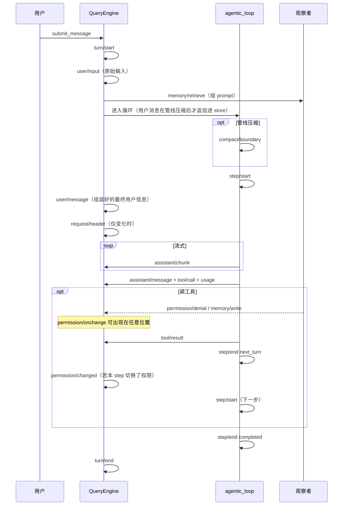

# 会话事件目录 —— 时机、顺序与载荷

> **文档角色：** 对照 `nono_agent/session/events.py` 的 `KNOWN_EVENT_TYPES`，说明 19 类事件**何时写出、彼此顺序、**`data` **长什么样**。读 jsonl / SSE / 回放时查本文。
> **配套文档：** 设计动机与门禁见 [Session-Observability-Design.md](./Session-Observability-Design.md)；怎么打开日志见 [USAGE.md §7](./USAGE.md)。
> **权威清单：** 类型常量以源码为准；本文示例来自当前发射点（`core/engine.py`、`core/loop.py`、观察者）。

磁盘上每一行都是同一个信封，差别只在 `type` 和 `data`：

```json
{
  "seq": 1,
  "type": "turn/start",
  "data": { "turn": 1 },
  "timestamp": 1787806043061.5,
  "ignorable": false
}
```

`seq` 在该会话事件流内自增；`timestamp` 是毫秒。下文示例只写 `data`。

查看顺序（新会话是 `.jsonl.zst`，用 `zstdcat`；旧的明文 `.jsonl` 用 `cat`）：

```bash
zstdcat ~/.nono-agent/sessions/<sid>.jsonl.zst | jq -c '{seq, type}'

{"seq":1,"type":"turn/start"}
{"seq":2,"type":"user/input"}
{"seq":3,"type":"memory/retrieve"}
{"seq":4,"type":"step/start"}
{"seq":5,"type":"user/message"}
{"seq":6,"type":"request/header"}
{"seq":7,"type":"assistant/chunk"}
{"seq":8,"type":"assistant/chunk"}
{"seq":9,"type":"assistant/chunk"}
{"seq":10,"type":"assistant/chunk"}
{"seq":11,"type":"assistant/chunk"}
{"seq":12,"type":"assistant/chunk"}
{"seq":13,"type":"assistant/chunk"}
{"seq":14,"type":"assistant/chunk"}
{"seq":15,"type":"assistant/chunk"}
{"seq":16,"type":"assistant/chunk"}
{"seq":17,"type":"assistant/chunk"}
{"seq":18,"type":"assistant/chunk"}
{"seq":19,"type":"assistant/message"}
{"seq":20,"type":"usage"}
{"seq":21,"type":"step/end"}
{"seq":22,"type":"turn/end"}
```

---


## 1. 一次 `submit_message` 的顺序


### 1.1 默认路径（无工具、无压缩、header 有变化）

```
turn/start
user/input                            ← 用户这一句的原始输入（原话，不参与 derive）
memory/retrieve                       ← 组装 system prompt 时检索（可能 0 条命中）
  │
  ├─ compact/boundary                 ← 仅管线真的 store.replace() 时（在 step/start 之前）
  │
step/start
user/message                          ← 组装好的最终用户信息（模型可见，参与 derive）
request/header                        ← 仅 initial / resume / change 时写
assistant/chunk × N                   ← 流式增量；log_assistant_chunks=False 则整段跳过
assistant/message                     ← content 块用 type 区分 reasoning(thinking) 与 text
usage
step/end                              ← reason=completed
turn/end
```


### 1.2 带工具调用

在 `assistant/message` 之后多一圈，然后**再开一个 step**：

```
… turn/start → user/input → memory/retrieve → step/start → user/message → request/header
assistant/chunk × N
assistant/message                     ← content 里带 tool_use
tool/call × M                         ← 紧跟这条 assistant，每个 tool_use 一条
usage
  │
  ├─ permission/denial                ← 工具执行中被拒才有
  ├─ permission/onchange              ← /permission 或 plan 工具随时可写（本 step 内不立刻改运行时）
  ├─ memory/write                     ← 工具/记忆系统写入才有
  │
tool/result × M                       ← 并行工具是连续多条
step/end                              ← reason=next_turn
  │
  └─ user/message                     ← 少见：stop-hook 校验失败、截断恢复提示
permission/changed                    ← 若本 step 内切换了权限，在下一 step 生效（at=step）
step/start                            ← 第二步：把工具结果送回模型
…
step/end                              ← reason=completed
turn/end
```


### 1.3 出错重试

插在当前 step 的流式请求里：**先收束再开新 step**。

```
step/start
  ├─ compact/boundary                 ← prompt_too_long 恢复替换了窗口
  └─ api/retry
step/end                              ← reason=fallback_model 或 api_error:…
step/start                            ← 重试
…
```


### 1.4 回合之外

`/compact`、`/clear` 在回合之间写 `compact/boundary`，不包在 `turn/*` 里。`memory/write` 只要 `admit()` 成功就会写，不必发生在某一 turn 内。

`/permission` 与 `enter_plan_mode` / `exit_plan_mode` **立刻**写 `permission/onchange`（可插在事件流任意位置），运行时仍用旧模式。新模式在**下一次** `turn/start` 或 `step/start` **之前**生效，并写 `permission/changed`（`at` 为 `turn` 或 `step`）。回合之间切换时顺序是：

```
… turn/end
permission/onchange                   ← 用户 /permission plan（from/to）
permission/changed                    ← 下一次 submit_message，at=turn
turn/start
…
```

resume 时 header 里已是目标模式，新进程没有进行中的 step，直接生效，不再补写 `permission/changed`。




### 1.5 一份带工具的回合（seq 示意）

用户说「算 6*7」，模型调一次计算器再回答。第二回合配置若没变，**没有**新的 `request/header`；`turn` / `step` 接着往下编号。


| seq | type                | 要点                       |
| --- | ------------------- | ------------------------ |
| 1   | `turn/start`        | turn=1                   |
| 2   | `user/input`        | `"算 6*7"`（原始输入）        |
| 3   | `memory/retrieve`   | query 即用户这句话             |
| 4   | `step/start`        | step=1                   |
| 5   | `user/message`      | `"算 6*7"`（组装好的最终消息）    |
| 6   | `request/header`    | reason=`initial`（本会话第一次） |
| 7…  | `assistant/chunk`   | 流式 token                 |
| 11  | `assistant/message` | 含 `tool_use` calculator  |
| 12  | `tool/call`         | call_id / args           |
| 13  | `usage`             | step 1 的 token           |
| 14  | `tool/result`       | `"42"`                   |
| 15  | `step/end`          | `next_turn`              |
| 16  | `step/start`        | step=2                   |
| 17… | `assistant/chunk`   |                          |
| 21  | `assistant/message` | `"答案是 42"`               |
| 22  | `usage`             |                          |
| 23  | `step/end`          | `completed`              |
| 24  | `turn/end`          | `COMPLETED`              |


---


## 2. 各类型：时机与 `data`


### 2.1 `turn/start` / `turn/end`

一次 `submit_message` 的外壳。`turn` 从 1 起，在同一条事件流内累加；`--resume` / 接续已有会话时从日志里已有的最大 `turn` 继续，不会从 1 重计。

```json
{ "turn": 1 }
```

```json
{ "turn": 1, "reason": "COMPLETED" }
```

`reason` 对齐 `SDKResultMessage.subtype`：正常是 `COMPLETED`，失败会带 `error_log_reconstruction_desync`、`error_model_error` 等。

发射者：`QueryEngine.submit_message`。

---


### 2.2 `user/input`

用户这一句的**原始输入**（原话）。位置：`turn/start` 之后、`step/start` 之前（期间可能夹 `memory/retrieve`）。它是观测/审计资产，**不参与** `derive_messages`；真正送进模型上下文的组装结果用 `user/message` 表达。

```json
{ "content": "帮我算 6*7" }
```

带附件时多一个 `attachments` 字段（原始附件原样保留）：

```json
{ "content": "看这张图", "attachments": [ { "type": "image", "source": { ... } } ] }
```

发射者：`QueryEngine.submit_message`。

---

### 2.3 `user/message`

模型调用请求开始时**最终要发送的、组装好的用户信息**。位置：`step/start` 之后、`request/header` 之前（第一步）；参与 `derive_messages`。三种来源，载荷形状相同：

1. 用户输入组装结果（turn 内第一步，几乎一定有）
2. stop-hook 注入的校验错误（后续 step 内）
3. 截断恢复提示（后续 step 内）

用户原话：

```json
{ "content": "帮我算 6*7" }
```

带附件时 `content` 是块列表：

```json
{
  "content": [
    { "type": "text", "text": "看这张图" },
    { "type": "image", "source": { "type": "base64", "media_type": "image/png", "data": "..." } }
  ]
}
```

工具结果**不是**这条事件，而是 `tool/result`。

发射者：`QueryEngine`（用户输入 + 循环 yield 出来的合成 UserMessage）。

---


### 2.4 `memory/retrieve` / `memory/write`

观察者事件，不经过消息流。

**retrieve**：每轮组 system prompt 都会调一次（即使用户没显式检索）；代码里另一次 `retrieve()` 会再写一条。位置：`user/input` 之后、`step/start` 之前。

```json
{
  "query": "帮我算 6*7",
  "memory_ids": ["mem_b20f6be00f86"],
  "kinds": ["semantic"],
  "adopted": true
}
```

没命中时 `memory_ids` / `kinds` 为空，`adopted` 为 `false`。

**write**：`admit()` 成功后立刻写，可发生在回合内任何时刻（常见是工具执行中）。

```json
{
  "memory_id": "mem_b20f6be00f86",
  "kind": "semantic",
  "adopted": true,
  "importance": 8.0
}
```

`adopted` 表示记录状态是否为 `accepted`。

发射者：`MemoryManager` 观察者 → `QueryEngine._stage_event`。

---


### 2.5 `request/header`

「模型当时被告诉了什么」。**不是每 step 一条**，只在 `initial` / `resume` / `change` 时写。位置：`step/start` → `user/message` 之后、循环流式之前。

`config` 携带模型提供商信息（协议标识）、提供商 ID 名称、模型 ID、模型协议与上下文窗口大小，配合 `system`（组装好的系统提示词全文）与 `tools`（有序工具 schema）完整表达请求配置：

```json
{
  "header": {
    "config": {
      "agent_id": null,
      "model": "claude-sonnet-4-20250514",
      "provider": "anthropic",
      "protocol": "anthropic",
      "context_size": 200000
    },
    "system": "You are Nono Agent...\n- [semantic] 用户偏好暗色主题",
    "tools": [
      { "name": "bash", "description": "...", "input_schema": { "type": "object" } }
    ]
  },
  "reason": "initial"
}
```

同一会话里后续回合配置没变，就不再出现这条。判定规则见设计文档 §5。

发射者：`QueryEngine._compute_request_header`（写入由 `submit_message` 在首个 `step/start` 之后完成）。

`request/header` 不是线上 HTTP 请求体。要看 SDK 发网前的 `params`，用 `EngineConfig.log_api_requests` / CLI `--log-api-requests`（见 [USAGE.md §2.2.1](./USAGE.md)），不要往事件流里塞。

---


### 2.6 `compact/boundary`

任何 `store.replace()`：管线自动压缩、恢复策略、`/compact`、`/clear`。

`kept` 是替换后的**完整窗口**（含边界标记本身）；`derive_messages` 遇到它就把消息数组整段换成 `kept`。

管线压缩（出现在该 step 的 `step/start` **之前**）：

```json
{
  "content": "[Context compacted by preprocess pipeline.]",
  "metadata": {
    "strategy": "pipeline",
    "model": "claude-sonnet-4-20250514",
    "estimated_tokens": 184320
  },
  "kept": [
    {
      "role": "system",
      "subtype": "compact_boundary",
      "content": "[Context compacted by preprocess pipeline.]"
    },
    { "role": "user", "content": "继续刚才的任务" }
  ]
}
```

`/clear`（回合之间）：

```json
{
  "content": "[Session cleared.]",
  "metadata": { "strategy": "clear" },
  "kept": []
}
```


| `metadata.strategy`                   | 触发                               |
| ------------------------------------- | -------------------------------- |
| `pipeline`                            | 预处理管线 `compact_boundary_created` |
| `manual`                              | `/compact`；另有 `removed`          |
| `clear`                               | `/clear`；`kept` 为空               |
| `reactive_compact` / `collapse_drain` | RecoveryChain 替换窗口               |


发射者：循环的 `SessionEventSink`（管线 / 恢复）+ 引擎的 `compact()` / `clear_session()`。

---


### 2.7 `step/start` / `step/end`

一次 LLM 请求 + 它引起的工具执行。编号从 1 起，**在同一 turn 内递增**；有工具就会 `1, 2, …`。成对出现。

```json
{ "turn": 1, "step": 1, "model": "claude-sonnet-4-20250514" }
```

```json
{ "turn": 1, "step": 1, "reason": "next_turn" }
```


| `reason`                        | 含义               |
| ------------------------------- | ---------------- |
| `completed`                     | 本 turn 正常结束      |
| `next_turn`                     | 还有工具结果要送回模型      |
| `fallback_model`                | 切了备用模型           |
| `api_error:prompt_too_long` 等   | RecoveryChain 重试 |
| `model_error` / `aborted_tools` | 失败或中止            |


发射者：`agentic_loop` via `SessionEventSink`。

---


### 2.8 `assistant/chunk`

`step/start` 之后、`assistant/message` 之前，每个 `StreamEvent` 一条。`chunk` 是该事件的 `model_dump()`。

```json
{
  "chunk": {
    "type": "content_block_delta",
    "index": 0,
    "delta": { "type": "text_delta", "text": "42" }
  }
}
```

`EngineConfig(log_assistant_chunks=False)` 时整类不写。不参与 `derive_messages`。

发射者：`QueryEngine` 消费 `StreamEvent` 时。

---


### 2.9 `assistant/message` + `tool/call` + `usage`

三条是一组，在完整 assistant 入库后**立刻连续写出**。`content` 里的块用 `type` 区分推理（`thinking`）与正文（`text`）：

纯文本回复：

```json
{
  "content": [
    { "type": "text", "text": "答案是 42。" }
  ]
}
```

带扩展思考（Anthropic thinking）时 `content` 会先有 `thinking` 块、再有 `text` 块：

```json
{
  "content": [
    { "type": "thinking", "thinking": "先算 6*7……", "signature": "..." },
    { "type": "text", "text": "答案是 42。" }
  ]
}
```

带工具时 `content` 里会有 `tool_use`，随后为**每个** block 写一条 `tool/call`：

```json
{
  "call_id": "toolu_01abc",
  "name": "calculator",
  "args": { "expression": "6*7" }
}
```

`usage`（这条 assistant 的用量；消息带 `usage` 字段才写）：

```json
{
  "usage": {
    "input_tokens": 1204,
    "output_tokens": 86,
    "cache_creation_input_tokens": 0,
    "cache_read_input_tokens": 0
  },
  "model": "claude-sonnet-4-20250514"
}
```

`tool/call` 和 `usage` 都不参与消息重建；重建只看 `assistant/message` 的 `content`。

发射者：`QueryEngine` 消费 `AssistantMessage` 时。

---


### 2.10 `permission/denial`

工具内部 `DenialTracker.record()` 时立刻插入，通常夹在 `tool/call` 和 `tool/result` 之间。

```json
{
  "tool": "denied_tool",
  "rule": "path outside sandbox",
  "mode": "default",
  "path": "/etc/passwd"
}
```

`path` 来自 `input_params["path"]`，没有就是 `null`。不参与重建，但是审计资产。

发射者：`DenialTracker` 观察者 → `QueryEngine._stage_event`。

---


### 2.11 `permission/onchange`

用户请求切换权限模式时立刻写入，**可出现在事件流任意位置**（回合之间的 `/permission`、某 step 工具执行中的 `enter_plan_mode` / `exit_plan_mode`）。`ignorable=true`。

这一刻**不改变**运行时 `PermissionPolicy.mode`；只把目标模式写入 `SessionHeader`，并挂起等待下一次 turn/step。

```json
{
  "from": "default",
  "to": "plan"
}
```

同值重复请求不写。连续切换会写多条（例如 `default→plan` 再 `plan→bypass`）；真正生效时 `permission/changed` 的 `from` 是当时的运行时模式，`to` 是最后一次挂起的目标。

发射者：`PermissionPolicy.request_mode` → `QueryEngine._on_permission_mode_request`。

---


### 2.12 `permission/changed`

挂起的权限模式在**下一次** `turn/start` 或 `step/start` **之前**应用到运行时，紧挨着那条边界事件。`ignorable=true`。

```json
{
  "from": "default",
  "to": "plan",
  "at": "turn"
}
```

`at` 为 `turn`（回合之间的切换，随下一次 `submit_message` 生效）或 `step`（本回合内切换，随下一个 LLM 请求生效）。本 turn 开头已经 `commit` 过则首个 `step/start` 不再重复写。

resume 从 header 恢复模式时不写本事件。

发射者：`QueryEngine._commit_pending_permission`（`submit_message` 的 turn 边界；`agentic_loop` 每个 `step/start` 之前）。

---


### 2.13 `tool/result`

每个工具结果一条。并行调用是**连续多条**，`derive_messages` 会把它们并进同一条 user 消息。

```json
{
  "call_id": "toolu_01abc",
  "result": "42",
  "is_error": false
}
```

中止时也会写占位结果（`is_error: true`），未完成的 `tool_use` 仍能配对。

发射者：`QueryEngine` 消费带 `tool_use_result` 的 `UserMessage` 时。

---


### 2.14 `api/retry`

当前 step 的请求失败、准备重试时写，紧接着 `step/end`，然后循环 `continue` 开新 step。

Fallback：

```json
{
  "attempt": 1,
  "max_retries": 1,
  "delay": 0.0,
  "reason": "fallback_model",
  "from_model": "claude-sonnet-4-20250514",
  "to_model": "claude-backup"
}
```

RecoveryChain（如 `prompt_too_long`）：

```json
{
  "attempt": 1,
  "max_retries": 3,
  "delay": 0.0,
  "reason": "prompt_too_long",
  "action": "reactive_compact"
}
```

若恢复时替换了窗口，**先**写 `compact/boundary`，**再**写这条。

发射者：`agentic_loop` via `SessionEventSink`。

---


## 3. 谁进 `derive_messages`


| 参与重建（模型上下文）                     | 不参与重建（观测 / 审计）                              |
| ------------------------------- | ------------------------------------------- |
| `user/message`                  | `turn/*`、`step/*`                           |
| `assistant/message`             | `user/input`（原始输入，只留痕不重建）                 |
| `tool/result`（连续的并成一条）          | `request/header`（单独用 `fold_request_header`） |
| `compact/boundary`（整段换成 `kept`） | `assistant/chunk`、`tool/call`、`usage`       |
|                                 | `api/retry`、`permission/denial`、`permission/onchange`、`permission/changed`、`memory/*`  |


看「当时模型看见了什么」用 `derive_messages(events)`；看「为什么这样、花了多少、拒了哪次」按 `seq` 读完整事件流。

---


## 4. 常用查询

```bash
# 一轮里做了几次请求、每次为什么结束
zstdcat ~/.nono-agent/sessions/<sid>.jsonl.zst | jq -c 'select(.type=="step/end") | .data'

# 模型当时的 system prompt / 工具
zstdcat ~/.nono-agent/sessions/<sid>.jsonl.zst | jq 'select(.type=="request/header") | .data.header'

# 压缩过几次、每次剩多少条
zstdcat ~/.nono-agent/sessions/<sid>.jsonl.zst \
  | jq -c 'select(.type=="compact/boundary") | {strategy: .data.metadata.strategy, kept: (.data.kept|length)}'

# 权限拒绝
zstdcat ~/.nono-agent/sessions/<sid>.jsonl.zst | jq 'select(.type=="permission/denial")'

# 权限模式何时被请求、何时生效
zstdcat ~/.nono-agent/sessions/<sid>.jsonl.zst \
  | jq -c 'select(.type=="permission/onchange" or .type=="permission/changed") | {seq, type, data}'
```

实时通道（脱敏后推送，信封与磁盘相同）：`GET /session/<sid>/events`，见 [USAGE.md §7.5](./USAGE.md)。
